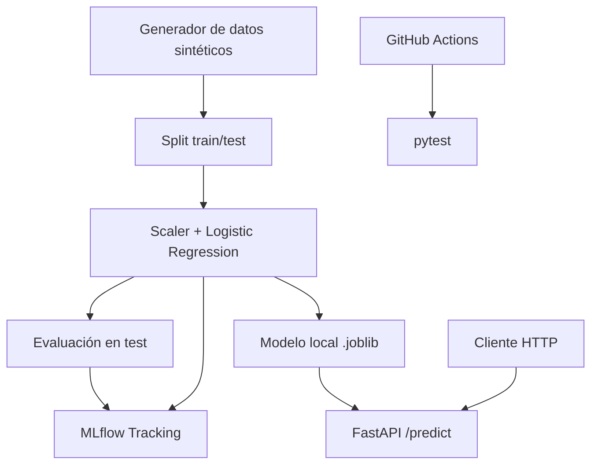

# Enterprise MLOps Platform


MVP **reproducible y gratuito** de MLOps con Python, Scikit-learn, MLflow, FastAPI, Docker y GitHub Actions. Proyecto de portafolio: no es un sistema empresarial desplegado en producción.

## Qué demuestra

- Generación de datos **100 % sintéticos** sin PII ni datasets externos.
- Separación de entrenamiento (train/test estratificado) y API de inferencia.
- Seguimiento local de parámetros, métricas y modelo con MLflow.
- Validación de entrada con Pydantic y documentación OpenAPI.
- Pruebas automáticas en GitHub Actions.
- Ejecución local o mediante Docker Compose.

## Arquitectura



## Requisitos

- Python **3.11** o 3.12 (recomendado 3.11), Git y VS Code.
- Docker Desktop opcional.
- Sin cuentas cloud, claves API ni tarjetas bancarias.

## Inicio rápido en Windows 11 / PowerShell

```powershell
git clone https://github.com/pierremedinaw/enterprise-mlops-platform.git
cd enterprise-mlops-platform
py -3.11 -m venv .venv
.\.venv\Scripts\Activate.ps1
python -m pip install --upgrade pip
python -m pip install -e ".[dev]"
python -m mlops_platform.train
python -m pytest -q
uvicorn mlops_platform.api:app --reload
```

> Si PowerShell bloquea `Activate.ps1`, usa `Set-ExecutionPolicy -Scope Process -ExecutionPolicy Bypass` en **esa sesión** o ejecuta `./.venv/Scripts/python.exe` sin activar el entorno.

La API se inicia en <http://127.0.0.1:8000/docs>. Para abrir MLflow en una **segunda terminal**, con el entorno activo:

```powershell
mlflow ui --backend-store-uri ./mlruns --host 127.0.0.1 --port 5000
```

MLflow estará en <http://127.0.0.1:5000>.

### Comprobar la predicción (PowerShell)

```powershell
$body = @{
    age = 38
    tenure_months = 12
    monthly_charges = 89.9
    support_tickets = 3
    month_to_month = $true
    autopay_enabled = $false
} | ConvertTo-Json

Invoke-RestMethod -Uri 'http://127.0.0.1:8000/predict' -Method Post -ContentType 'application/json' -Body $body
```

La respuesta incluye `churn_probability`, `predicted_churn` y `threshold`. **No tiene validez comercial** porque el entrenamiento usa etiquetas simuladas.

### Ejecutar con Docker

Desde la raíz del proyecto, con Docker Desktop activo:

```powershell
docker compose build
docker compose run --rm trainer
docker compose up -d api
```

Luego abre <http://127.0.0.1:8000/docs>. Detén el servicio con `docker compose down`.

## Estructura

```text
enterprise-mlops-platform/
├── .github/
│   └── workflows/
│       └── ci.yml
├── artifacts/
│   └── .gitkeep
├── src/
│   └── mlops_platform/
│       ├── __init__.py
│       ├── api.py
│       ├── data.py
│       └── train.py
├── tests/
│   ├── test_api.py
│   └── test_data.py
├── .dockerignore
├── .gitignore
├── compose.yaml
├── Dockerfile
├── LICENSE
├── pyproject.toml
└── README.md
```

## Métricas y limitaciones

El entrenamiento registra ROC-AUC, accuracy, precision, recall y F1. Los resultados **no se presentan como desempeño sobre clientes reales**. Para producción faltan, entre otras cosas, gestión segura de versiones de modelos, autenticación, monitorización, observabilidad, gestión de secretos, tests de carga, despliegue controlado y datasets representativos.

> Seguridad: `joblib` usa serialización pickle. Carga exclusivamente artefactos generados en un entorno confiable; nunca deserialices modelos descargados de fuentes desconocidas.

## Próximas mejoras

- Pipeline CI con formato, análisis estático y auditoría de dependencias.
- Registro y promoción de modelos por versiones.
- Detección de data drift, monitoreo y controles de calidad.
- Adaptadores opcionales para Databricks / Azure (sin credenciales en el repositorio).

## Licencia

MIT. Consulta [`LICENSE`](LICENSE).
